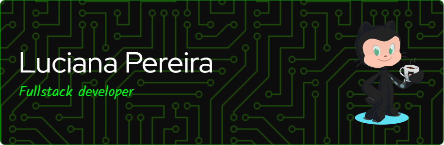

  

### Software Engineer | Full Stack Developer | Solution Architecture | Cloud & AI

*Building scalable software solutions through engineering, architecture, and innovation.*

 

---

## 👩‍💻 About Me

I'm a **Software Engineer and Full Stack Developer** with professional experience building, maintaining, and evolving enterprise software solutions.

Currently working at **Avanade**, contributing to software development initiatives involving backend engineering, APIs, integrations, and scalable applications.

My technical expertise includes **C#, .NET, JavaScript, TypeScript, React, Angular, Node.js, Java, and Python**, complemented by experience with relational and NoSQL databases, cloud technologies, containerization, and DevOps practices.

Beyond software development, I'm continuously expanding my knowledge in **Solution Architecture, Cloud Computing, Artificial Intelligence, Data Engineering, and Project Management**.

I believe successful technology solutions require more than technical implementation: they demand architectural vision, engineering excellence, collaboration, and alignment with business objectives.

### 🎯 Professional Interests

- Software Engineering & Solution Architecture
- Distributed Systems & Microservices
- Backend Engineering & API Design
- Cloud Computing & DevOps
- Artificial Intelligence & Data Engineering
- System Integration & Enterprise Architecture
- Project Management & Technical Leadership
  
---

## 🏛️ Education & Academic Background

<table>
  <tr>
    <td width="65" align="center">
      
    </td>
    <td>
      <b>MBA in Solution Architecture & Artificial Intelligence</b> 
      FIAP — Faculdade de Informática e Administração Paulista
    </td>
  </tr>
  <tr>
    <td align="center">
      
    </td>
    <td>
      <b>MBA in Project Management</b> 
      USP/ESALQ — University of São Paulo
    </td>
  </tr>
  <tr>
    <td align="center">
      
    </td>
    <td>
      <b>Internet Systems Technology Degree</b> 
      FIAP (Concluído em Jul/2024)
    </td>
  </tr>
   <tr>
    <td align="center">
      
    </td>
    <td>
      <b>Computer Engineering</b> 
      UNIVESP - Virtual University of the State of São Paulo
    </td>
  </tr>
</table>

<b>📜 See other courses and bootcamps</b>

 

* **Software Engineering** — 42 São Paulo *(Architecture Track)*
* **Bootcamp Full Stack Web Development** — Laboratoria *(5ª Edição)*

---

## 🏆 Certifications & Professional Credentials

### Software Engineering & Architecture

  
  

### Cloud & Green Software

  

**Additional Credentials**

- MongoDB Associate Certification
- MongoDB SI Architect Certification
- LFC131 — Green Software for Practitioners
- 42 Certified

---

## 🌐 Community & Leadership

### Google Cloud Arcade — Facilitator

Supporting students and early-career professionals in discovering Google Cloud learning opportunities, developing technical skills, and engaging with the cloud technology ecosystem.

**Facilitator Code:** `GCAFBR-26-4735`

  

---

## 🛠️ Technical Skills

### Programming Languages

### Frontend Development

### Backend & Frameworks

### Databases & Data Engineering

### Cloud, Infrastructure & DevOps

### Architecture & Engineering Practices

- RESTful APIs & Microservices
- Distributed Systems
- Clean Architecture
- Domain-Driven Design
- Software Design Patterns
- Agile Methodologies (Scrum)
- CI/CD & DevOps
- System Integration

---

## 📊 GitHub Analytics

---

## 🤝 Let's Connect

I'm always open to exchanging knowledge, collaborating on innovative projects, and connecting with professionals passionate about technology, engineering, and architecture.

  
  
  

---

### *Engineering the future, one solution at a time.* 🚀

